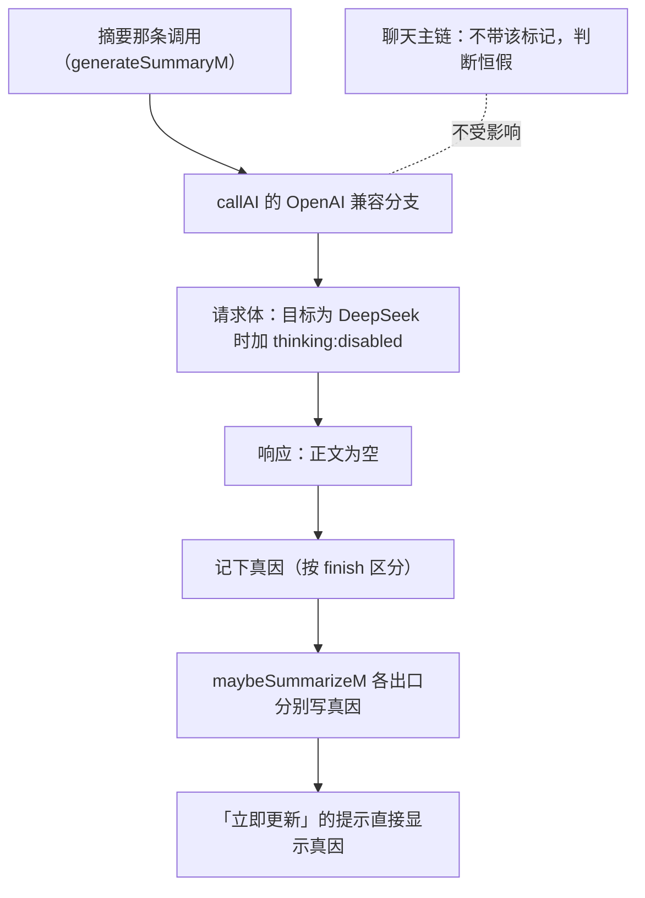

# PR 正文（参考实现 · 与 06 的 issue 关联 · 已外发）

**状态**：**已提交（2026-09-19）** —— PR **#6**，`draft`、不请求合并，正文首行 `refs #5` 互链；**issue #5 关闭时一并关掉**。线上正文与本地逐字节一致（已回读核对，「我」0 次）。
**形态**：**与 issue 关联的"参考实现"PR** —— 不是请求合并（开发者已说明 IB 按"修订单 + 单文件提交"落地、不直接合并 PR）。用途是：把**可对照的 diff** 挂在 issue 旁边，方便一处看机制、一处看改动；issue 关闭时可以一并关掉它。  
**目标仓库**：`Sui-IB/InternalBeyond-Mobile`（从本账号 fork 的分支提）  
**建议分支名**：`ref/mobile-summary-nothink`  
**PR 标题建议**：`摘要更新失败：参考实现（对应 issue #5）`  
**正文里要写**：开头一行 （已开：issue #5 → PR #6；正文的首句与标题均已填入 #5）
**⚠️ 号已填**：issue = **#5**、本 PR = **#6**（draft）。落稿时三处占位曾有两种写法（ 与 ），已统一成 。
**依据版本**：`1e2725b0`（V2.4.4）；`index.html` 3,304,065 B，sha256 `c16aca6e…30511`

**内部备注（不随正文发出）**

- **PR 版与镜像版的唯一差别**：PR 版不含镜像专用项（`IB_VER=v262-p-r6` 那处标记、以及探针页 `ib-ver.html`）。两版由同一脚本生成：`IB_PR=1 node _mk_summary_patch.js <上游原文> index.html` 得到 PR 版，不带环境变量得到镜像版。已逐行核对：两份只差 `IB_VER` 一行。
- 补丁文件（PR 用）：`Android\IB-摘要修复-PR版.diff`（12 处锚点，81 行）。
- 检查结论：**Standards 轴零硬性违反**（标记 `fix-r6` 合上游 `fix-r*` 形态、`_noThink` 属 `pa._no<特性>` 家族、`_sumLastErrM` 属 `_sum*M` 家族；无镜像专用项混入）；**Spec 轴一条已修**（空正文的文案原先一律说成"思考吃光"，现按 `finish` 区分，对齐电脑端 `:12207` 口径）。

---

# 摘要更新失败的参考实现（对应 issue #5）

缺陷与机制写在 **issue #5**，这里只放**改动的形态**，便于对照。

### 改了什么

只碰 `index.html` 一处功能（`generateSummaryM` / `maybeSummarizeM` 及其请求体构造），共 12 个锚点：



1. **摘要请求带一个"不许思考"的标记**（只挂在这一条调用上，聊天不带）；
2. **OpenAI 兼容分支**：带该标记**且**目标是认识该参数的服务商（`provider==='deepseek'` 或地址含 `deepseek.com`）时，往请求体加 `thinking:{type:'disabled'}` —— 目标不认识就不加，避免制造 400；
3. **失败出口各自给出可读的原因**，提示直接显示它（不再套统一前缀）：
   - 已有一轮在跑 / 窗口之外已无要补的内容（这两种都**不是故障**）；
   - 空正文（**按 `finish` 区分**："输出预算被思考吃光"只在 `finish=length` 时这么说，其它空返如实描述——与电脑端取正文处同一口径）；
   - 没有可用 Key / 摘要未启用 / 频道记录读不到 / 读本地记录失败 / 整理期间封档线变了。
4. 该原因字符串**每次尝试前先清空**，避免读到上一次的陈旧原因。

请求体的形状（改动很小，只多一个字段）：

```diff
  {
    "model": "…",
    "messages": [ … ],
    "max_tokens": 4000,
+   "thinking": { "type": "disabled" }
  }
```


### 没动什么

- **没动那条 4000 的上限**（issue 里已说明那是既有取舍；要报的是"上限之下没有关闭思考的路径"）；
- **没动聊天主链**（`_noThink` 只由摘要那条调用传入，聊天调用不传，判断恒假）；
- 没动 `ib-sw.js`、备份格式、数据库结构；改动只落在 `index.html`。

### 验证状态

已完成静态与逻辑层验证，并在自建的一份同源副本上打同款补丁做**真机复测**：摘要恢复更新，"覆盖至"日期前进；摘要请求的输出从"固定顶到上限"降到 655 / 1200。更大范围的真机验证仍在进行中。

### 收口方式

如果方向不一致，直接关掉也完全没问题的💗。
